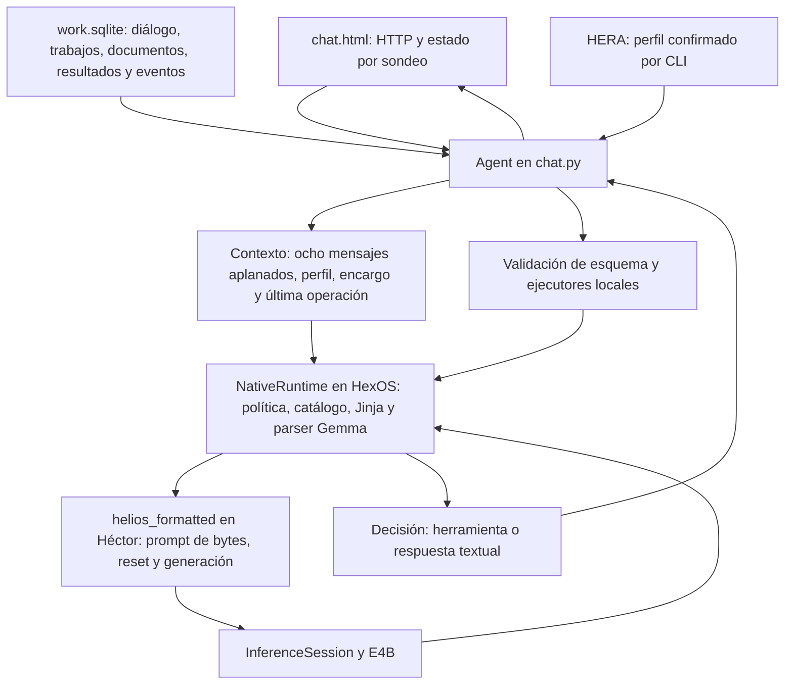

# Auditoría de conversación real y arquitectura

> **Documento histórico / evidencia de una fase.** Sus pendientes y pruebas
> describen ese corte, no el producto actual. [Estado vigente](../IMPLEMENTATION_STATUS.md)
> (revisado 2026-09-19).

Fecha: 2026-09-12. Investigación local con E4B, sin cambios al comportamiento
del servidor. Se añadieron instrumentos de diagnóstico; no se considera corregido
el chat. No se modificaron dispositivos ni se creó un commit.

Seguimiento: [corrección conversacional aplicada](CONVERSACION_NATIVA_CORRECCION.md).
Este informe conserva el estado y las observaciones anteriores a esa corrección.

## Conclusión

La ruta nativa puede emitir llamadas válidas, ejecutar herramientas y continuar.
También puede terminar con pseudollamadas, negar datos presentes y reutilizar sus
propias respuestas equivocadas. El fallo de la captura se reproduce con el motor
real. Pasar el banco de herramientas no demuestra fiabilidad conversacional.

No hay una única causa demostrada. Hay sensibilidad al historial y al catálogo,
y defectos comprobables de integración que permiten convertir esos errores en
respuestas finales aceptadas. Cambiar a mensajes con roles no resolvió por sí solo
la conversación. Un reintento de formato tampoco bastó.

## Método y límites

- Snapshot SQLite mediante backup de una conexión de solo lectura. Cada turno
  histórico se reconstruye sobre una copia temporal, eliminando los mensajes y
  eventos de herramientas desde ese turno. Se conservan el estado persistente y
  el límite de contexto del snapshot: no es una reconstrucción temporal universal.
  En estos casos, el encargo activo tiene fecha anterior a los turnos investigados.
- Política y código actuales; perfil HERA vacío, igual que el observado al revisar.
  Las negativas de las 14:04 preceden al arranque de las 14:14 y a cambios de
  política. No se atribuyen automáticamente a la versión actual. Las dos
  pseudollamadas de las 14:57 sí se reprodujeron literalmente con el código actual.
- Una sola carga de pesos a la vez. El chat estuvo pausado durante cada banco y
  se restauró con sus argumentos y entorno. Comparación posterior: conversation,
  tool_events, agent_reports, agent_state y jobs iguales al snapshot.
- 25 generaciones de comparación: 19 iniciales y seis ablaciones posteriores.
  Además, seis turnos del Agent real con datos sintéticos, incluido reset.
  Se guardan prompt renderizado, mensajes, salida cruda, motivo de terminación,
  llamadas detectadas y latencia del puente. No hay una tasa global de acierto:
  son casos distintos, una ejecución por variante y evaluación manual de utilidad.
- Mismo puente helios_formatted, contexto 8192, temperature=0, sin pensamiento,
  1536 tokens visibles máximos y reconstrucción de KV por generación.
  No se compararon otros pesos, otro backend ni pensamiento en este estudio.
- La plantilla local tiene SHA256
  `0a2c8073c878ab1da004bee933a998606537bbb62016310352c7285c3f01c5b5`.
  Esto identifica el archivo utilizado; no constituye una verificación externa
  nueva de su procedencia.

## Resultados del modelo real

| Caso y cambio | Resultado observado |
|---|---|
| «sabes quien soy?» con montaje actual | `history_search(query="quien soy")`, EOS, cero llamadas nativas |
| «te he preguntado» con montaje actual | Misma pseudollamada, EOS, cero llamadas nativas |
| Conservar roles, misma política/catálogo y metadatos en el mensaje actual | «No.» ante la pregunta de identidad |
| Roles y estado en system | «No.» ante identidad; pseudollamada ante la insistencia |
| Roles, política mínima, sin metadatos | Niega saber quién es la persona, con 16 herramientas y sin herramientas |
| Corregir las negativas anteriores del asistente, conservando el montaje plano | «Andrés.» |
| Repetir la presentación al final del mensaje actual | «Eres Andres, mi creador.» |
| Mantener montaje e historial originales, limitar catálogo a history.* | «Eres Andres.» |
| Roles y solo antecedentes escritos por el usuario | «Tu nombre es Andrés.» |
| Roles y negativas anteriores del asistente corregidas | «Tu nombre es Andrés.» |
| Reintento tras avisar que la pseudollamada no se ejecutó | `history_recent()`, todavía texto final sin llamada |
| Conversación limpia: Marta → pregunta por nombre | «Te llamas Marta.» |
| Petición explícita de buscar el nombre con history_search | Llamada nativa válida, con query «mi nombre» |
| Continuación desde un resultado de procedure_list | Respuesta legible sobre pending_report |

La sustitución/omisión de respuestas previas fue exclusivamente una ablación sobre
copias. No se propone reescribir el historial real ni eliminar todas las respuestas
del asistente en producción. Cambiar esa información cambia el resultado en estos
casos; no prueba un mecanismo interno ni garantiza el mismo efecto en otros.

En el Agent completo y aislado, Marta → pregunta → corrección Elena → pregunta
devolvió los nombres correspondientes; procedure.list se ejecutó y explicó.
Después de reset, buscó «nombre» y recuperó Elena. Sin embargo, al corregir dijo
«El nombre ha sido actualizado a Elena» sin herramienta de escritura de perfil:
la formulación sigue siendo ambigua sobre persistencia. No se debe contar toda
la secuencia como éxito de memoria personal solo porque acertó los nombres.

## Arquitectura que realmente ejecuta este chat



Es una ruta Python experimental paralela al servidor C existente. No pasa por el
ciclo CK legacy. HERA aquí aporta lectura de perfil, no dirección del agente ni
escritura automática de recuerdos. El puente nativo actual no incorpora visión,
streaming ni cancelación de usuario. El resumen pending_report lo construye un
procedimiento determinista; estas operaciones no equivalen a administrar servidores.

## Hallazgos de implementación

1. **No hay un contrato suficiente para la respuesta final.**
   `native.py`, NativeRuntime.generate, reconoce `<|tool_call>`; si llega EOS sin
   esos marcadores devuelve cualquier texto como reply. Por eso una pseudollamada
   y una cadena vacía terminan aceptadas. No es la interfaz ocultando una ejecución:
   la traza cruda de los turnos reproducidos contiene exactamente ese texto.
   La reparación de formato de Agent captura InvalidDecision de JSON; NativeSyntax
   no usa esa vía. No debe ejecutarse pseudocódigo para suplir esta carencia.

2. **La continuidad guarda contenido, pero pierde estructura y fiabilidad.**
   `chat.py`, Agent.chat, hace reset por turno y convierte ocho mensajes en texto
   dentro de un mensaje user. IDs y fechas ocupan espacio, las respuestas fallidas
   vuelven al contexto sin un estado que indique el fallo, y las llamadas antiguas
   no conservan allí sus bloques nativos. Solo se añade la última operación.
   El dato del nombre estaba entre los ocho mensajes: este fallo concreto no fue
   una expulsión por límite de ventana. El siguiente turno sí puede perderlo.

3. **Recuperación literal y perfil son capacidades distintas.**
   `continuity.py` busca subcadenas en mensajes de ambos roles. Buscar «quien soy»
   no recupera necesariamente «soy andres»: puede encontrar la pregunta o la propia
   pseudollamada. Las respuestas del modelo no son evidencia independiente de un
   hecho personal. No existe herramienta para escribir el perfil HERA desde el chat.
   Persistir conversación no equivale a confirmar memoria personal.

4. **La autorización de guardado sigue dependiendo del modelo.**
   `workflow.py` verifica turno fuente, resultado existente e idempotencia, pero
   no que ese turno autorice guardar. `catalog.validate` comprueba esquema y tipos.
   Los campos effect/permissions no constituyen una barrera de autorización.
   Sonda reproducida con decisiones simuladas: ante «Solo dame ideas; no guardes
   ni cambies nada», una llamada válida a report.save guardó el informe temporal.
   Esto demuestra una carencia del ejecutor, no que E4B haya cometido ese fallo
   espontáneamente en esta conversación. Afecta también a la ruta JSON.

5. **El límite del chat no es el del laboratorio.**
   `for _ in range(6)` cuenta decisiones, incluyendo la respuesta final y reintentos.
   Seis consultas correctas seguidas de una respuesta no caben: la sonda ejecutó
   las seis, luego terminó con «Se alcanzó el límite de consultas del turno».
   El parser admite hasta seis llamadas juntas, pero cada una consume una iteración.
   Se necesitan presupuestos separados de llamadas, generaciones y finalización.

6. **La división de responsabilidades está a medio terminar.**
   HexOS conserva correctamente los ejecutores; Héctor no tiene lógica doméstica.
   Pero NativeRuntime concentra transporte, política del producto, adaptación de
   catálogo, plantilla específica y parser, mientras Agent sigue suponiendo el
   contrato JSON reply/work. El plan atribuye plantillas/adaptadores a Héctor; hoy
   esta parte vive en HexOS y el motor recibe bytes. El puente es útil para probar,
   pero falta un contrato común de eventos que no dependa del formato del modelo.

7. **La observabilidad productiva es insuficiente para diagnosticar retrospectivamente.**
   tool_events prueba ejecuciones, pero no registra salidas rechazadas, finish reason,
   plantilla/política utilizada ni snapshot exacto del contexto. Al recargar, la UI
   recupera mensajes sin los paneles históricos de herramientas. El banco añadido
   conserva esos datos en privado; no se ha habilitado ese registro en producción.

## Orden de corrección propuesto

1. Definir eventos comunes: respuesta, solicitud de herramienta, resultado y fallo,
   con IDs y motivo de terminación. Separar «terminó la generación» de «se entregó
   una respuesta válida». Detectar finales vacíos y pseudollamadas evidentes sin
   convertirlas en acciones. Recuperación acotada y fallo explícito si persiste;
   el reintento ensayado no permite prometer reparación automática.
2. Introducir autorización de efectos en el ejecutor: alcance configurado y
   autorización verificable vinculada a operación/recurso, independiente de que
   el modelo produzca argumentos válidos. Las lecturas permitidas pueden seguir
   ejecutándose sin preguntas. No sustituir autorización por palabras clave.
3. Construir contexto con roles y procedencia; conservar en disco también los
   errores, distinguiéndolos al reinyectarlos. Presupuestar por tokens, separar
   perfil confirmado, diálogo y resultados. Evaluar catálogo completo y selección
   contextual sin ocultar capacidades necesarias. Roles solos no bastaron aquí.
4. Aislar política HexOS del adaptador de modelo y acordar la API con Héctor.
   Mantener en HexOS ciclo, permisos, herramientas, memoria y trazas; dejar formato,
   tokens, generación y continuidad al adaptador/motor. No añadir otro modelo.
5. Repetir aceptación con diálogo real y perturbaciones: presentación, corrección,
   errores previos del asistente, cambio de tema, reinicio, búsqueda vacía, respuesta
   tras herramienta, seis llamadas más final y petición de ideas sin escritura.
   Medir por separado fidelidad, ejecución, autorización y respuesta útil.

No procede sustituir definitivamente JSON ni conectar nuevos dispositivos sobre
la sola base del laboratorio. Tampoco se ha demostrado que haya que abandonar E4B
o el protocolo nativo: las pruebas limpias muestran capacidades que la integración
todavía no consigue hacer consistentes.

## Reproducción y archivos

- `tools/native_conversation_audit.py`: replay con snapshot, trazas y ablaciones.
- `tools/native_architecture_probe.py`: sondas sin GPU, con decisiones simuladas.
- Evidencia privada, excluida por runtime/logs/: `runtime/logs/native-conversation-audit/`.
  results.json y followup.json contienen prompts y salidas; architecture.json,
  las sondas. snapshot.sqlite conserva el origen de los casos. No publicar esos
  archivos junto al informe: incluyen conversación personal.

Con GPU libre y servidor pausado, restaurándolo después con sus argumentos:

```bash
python3 tools/native_conversation_audit.py --source /ruta/snapshot.sqlite \
  --runtime /ruta/helios_formatted --model /ruta/modelo.hnf \
  --template /ruta/chat_template.jinja --output /ruta/privada/results.json
# Para las seis ablaciones posteriores: añadir --followup --rows 54
python3 tools/native_architecture_probe.py
```

Los rowids predeterminados pertenecen a este snapshot. Para otro historial hay que
seleccionar los turnos fuente y revisar la reconstrucción de estado; no interpretar
el script como un benchmark universal. Las ablaciones followup se diseñaron para
el contenido del turno 54 de este incidente.
